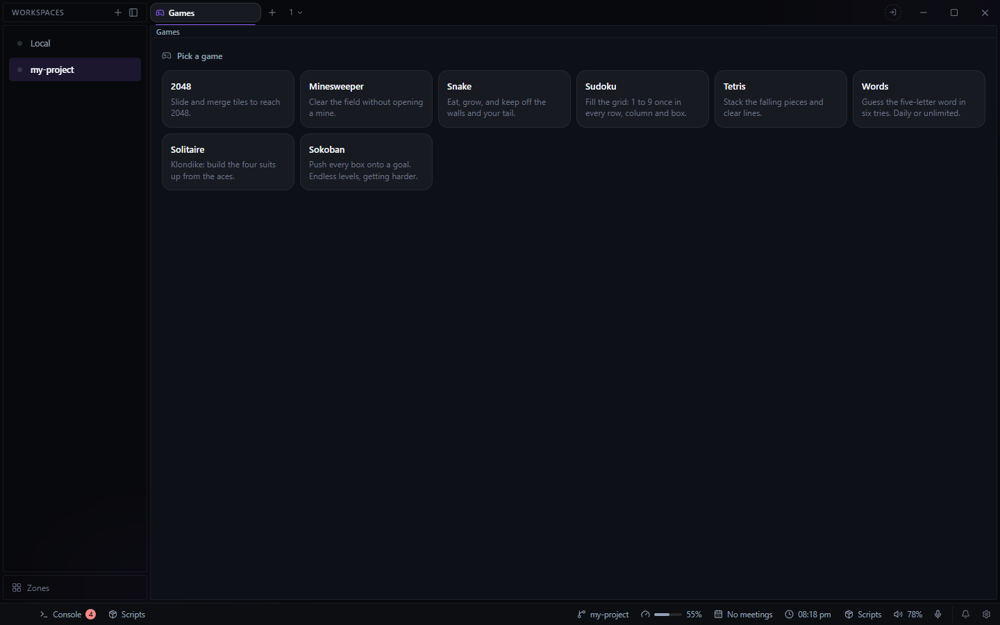

# Games for Deck

Mini games in a pane. Open it from the **+** beside your tabs and choose **Games**; it opens on a
picker, and **Games** at the top goes back to it.

Each game saves as you play: which game is showing and its whole state (the board, the score, the
best score) come back after a reload or a restart of Deck. Saves live in Deck's config on this
machine (`plugin-games.json`).

## Games

- **2048**: arrow keys or WASD (or drag on the board) to slide tiles; equal tiles merge. U undoes
  one move, N starts a new game.
- **Minesweeper**: three sizes; the first open is always safe. Click opens, right-click flags, a
  click on an open number opens the rest once its flags are placed; arrows, Space, F and N too.
  Best time per size.
- **Snake**: arrows or WASD, Space or P pauses, N starts again. Runs only while its pane has
  focus; a saved game comes back paused.
- **Sudoku**: generated puzzles with one solution, three levels. 1-9 to fill, right-click or
  Backspace to clear, Space or Shift+digit for notes, hint, undo. Best time per level.
- **Tetris**: arrows move, Up or X rotates, Z rotates back, Space drops, C holds, P pauses. Levels
  every ten lines.
- **Words**: a five-letter word in six tries. Daily (one a day, with a streak) or unlimited.
  Letters ruled out turn red on the keyboard, and in red when typed again.
- **Solitaire**: Klondike, draw 1 or 3. Click a card and then where it goes; double-click sends it
  home. U or Ctrl+Z undoes, and Finish shows once every card is face up.
- **Sokoban**: ten hand-made levels, then generated ones for ever, bigger and with more boxes as
  you go. A generated level is built by playing backwards from the solved position, so it can
  always be solved, and a level number is always the same level. U or Ctrl+Z undoes, R restarts,
  Enter goes on once a level is solved.

Timed games count only while the game is on screen and the window is visible.
